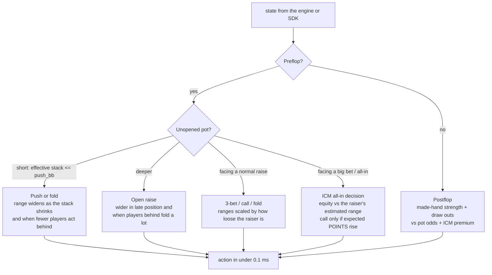

# Pokerbot Arena

**A tournament no-limit hold'em bot with ICM-aware decisions and live opponent modeling, plus the simulation lab used to build, test and tune it.**

**[▶ Live demo: watch the bot play or sit down against it](https://vaibhaav-tiwari.github.io/pokerbot-arena/)**: the real Python engine and bot run in your browser via Pyodide. No server.

Built for Deep-ML's **No Limit: Pokerbot Tournament** (Nov 2026): 8-player sit-and-gos, 2,000 chips, blinds rising every 25 hands, **1 ms per decision**, and only the top three of each table scoring (10 / 5 / 2, ICM split at the 200-hand cap).

| | |
|---|---|
| Entry leaderboard | **Top 10 of 30** entrants, best demo score **5.93** points per table (named entry) |
| Decision speed | **3.3 µs median**, 96 µs worst, against a 1,000 µs limit |
| Reliability | **0 errors** and 0 timeouts in every contest submission |
| Evaluation | 100k+ simulated tournaments, paired seeds, holdout checks |

---

## Contents
1. [What the live demo does](#1-what-the-live-demo-does)
2. [How the bot thinks](#2-how-the-bot-thinks)
3. [The simulation lab](#3-the-simulation-lab)
4. [Results and what I learned](#4-results-and-what-i-learned)
5. [Contest-day engineering](#5-contest-day-engineering)
6. [Repository layout](#6-repository-layout)
7. [Run it yourself](#7-run-it-yourself)
8. [Limitations and next steps](#8-limitations-and-next-steps)

---

## 1. What the live demo does

| Tab | What happens |
|---|---|
| **Watch the bot** | Deals a full 8-player sit-and-go (up to 200 hands) between **VT-Bot** and either the contest's house bots or four independently written AI contest bots, then replays it hand by hand: cards, bets, showdowns, eliminations, a chip-stack graph and final ICM points. Pick any seed. |
| **Play against it** | Sit down heads-up against VT-Bot, or at a full table with VT-Bot and six house bots. You act with Fold / Call / Raise (slider and pot presets); VT-Bot decides with the same code that was submitted to the contest. |
| **Lab & results** | The experiment results below, and an interactive ICM calculator. |

The page loads Pyodide in a Web Worker, copies the Python files from `docs/py/` into its virtual filesystem, and calls `web_api.py`. The engine's game loop is a Python **generator**, so a human seat simply suspends the game until the browser sends an action.

## 2. How the bot thinks



**Hand strength.** All 169 starting hands are precomputed: equity against a random hand, and equity against the top 3%…100% of hands (`range_equity.json`). At play time a decision is a few table lookups.

**ICM, not chips.** Only the top three score, so a chip won is worth less than a chip lost. For any all-in call the bot computes expected points of calling vs folding with the Malmuth-Harville model (an O(n²) closed form, ~6 µs for 8 players), using its equity against the shover's estimated range. Elsewhere it scales its ranges by an **ICM premium**: how much more than 50% equity a stack-for-stack flip needs right now.

**Opponent modeling.** Per seat it tracks VPIP, preflop raise and shove frequency, fold-to-raise and postflop fold rate. That gives the raiser's likely range (a 5%-raiser's shove gets respect, a maniac's doesn't), where to steal, and who never folds (no bluffs, thinner value bets).

**Late-game switch (final entry).** The submitted bot plays a balanced strategy for 100 hands and then switches to more aggressive settings, because analysis of its losses showed it surviving to the 200-hand cap as the 2nd-largest stack too often (1st place at the cap pays ~7–8 points via ICM, 2nd only ~6).

Every number in the strategy (≈30 of them) is a parameter in `mybot.py`'s `DEFAULT_PARAMS`, tuned by self-play.

## 3. The simulation lab

| Piece | File | What it does |
|---|---|---|
| Engine | `engine.py` | Full NLHE sit-and-go: blinds and antes, side pots, heads-up rules, bust order, ICM payout, per-seat 1 ms clock (late or crash = check/fold). A generator, so humans can play. |
| Evaluator | `cards.py` | Pure-Python 7-card evaluator (~3 µs). |
| Opponents | `bots.py`, `field/` | Practice styles (tag, nit, lag, maniac, station, rock, random, crashing bot), **exact re-implementations of the contest's house bots**, and **four contest bots written independently by AI agents** (a tournament specialist, a Monte Carlo equity bot, a loose-aggressive exploiter, and an RL bot trained by evolution strategy). |
| Benchmark | `run.py`, `leaderboard.py` | Thousands of tables in parallel; every seat's points, top-3 and 1st-place rates. |
| Style analysis | `analyze.py` | VPIP, PFR, shove %, aggression factor, showdown stats and where each bot's chips come from. |
| Tuning | `tune.py` | Hill climbing / evolution strategy with **common random numbers** (every candidate plays the same seeds) and a **holdout** check on fresh seeds before anything is saved. Objective: average points, or outright wins. |
| Learned policy | `mybot4.py`, `train_v4.py` | Linear postflop policy over 15 features trained with an antithetic evolution strategy (~150k games). |
| Robustness | `degraded.py` | Replays the bot with less information (no history, no stacks, no position) to test sparse contest APIs. |

## 4. Results and what I learned

**Overfitting was the biggest lesson.** Tuned against simple practice bots, the bot scored over 5 points per table there but finished **last** against realistic opponents. The practice bots knocked each other out so quickly that a bot that only checks and folds scored 3.83 against them. Re-tuning against the AI-written field fixed it:

| Average points per table vs the AI-written field (2,000 tables) | |
|---|---|
| v2 tuned on weak practice bots | 1.26 (last) |
| v2 untuned | 1.95 |
| v2 re-tuned on the AI field | 2.30 |
| **v3** | **2.37 (2nd of 5)** |
| best AI-written bot (RL, evolution strategy) | 2.67 |

An average seat earns 2.125 (17 points ÷ 8).

**Why the RL bot was ahead: style.** `analyze.py` showed an aggression factor of **18** (it almost never calls after the flop: it bets or folds) and the most chips won without a showdown. Mine was 0.8–1.5.

**Experiments that did *not* help, kept honest.**
- *v3*, adding tunable semi-bluffs, barrels and stabs, tied v2 (2.30 vs 2.30).
- *v4*, replacing the postflop rules with a learned linear policy plus a 12-sample equity simulation, tied v3 (2.17 / 2.59 / 2.37 vs 2.28 / 2.55 / 2.35 on three fields) and timed out more under load, so v3 stayed.

**Speed: 3× faster with identical decisions.** ICM is skipped whenever bounds prove it can't change the answer (it can only shrink a range by 25–100%), plus a faster ICM and lookup tables. Median **11.3 → 3.3 µs**, worst **177 → 96 µs**, verified by replaying **137,972 decisions with 0 differences**. Remaining timeouts in testing came from machine load (load average 138), not code.

**What the contest API exposes matters.** Before the contest I measured the bot with progressively less information: full **2.32**, no action history **1.78**, no opponent stacks **1.53**. That test found a bug where missing history would have crashed the all-in logic and **silently folded ~27,000 decisions**. Now the raiser is inferred from bets when there's no history.

**Against the contest's house bots.** Once I could read the SDK, I re-implemented its five reference bots exactly (Chen-formula preflop chart, 120-sample equity postflop, etc.) and checked the copies against known `preflop_strength` values.

| Version vs exact house bots (1,500 tables) | Points | Top 3 | 1st |
|---|---|---|---|
| Balanced (v3, AI-field tuned) | 5.68 | 77% | 37% |
| Aggressive | 6.08 | 75% | 53% |
| **Final: balanced, aggressive from hand 100** | **6.05** | **77%** | **51%** |

**The 8 demo tables are deterministic.** The entry score replays the same 8 deals for everyone, so resubmitting a bot with a new random seed doesn't give a fresh draw. A bot that's stronger on average can still score lower on those particular deals. Strategy changes have to be judged on large samples, not on one demo run.

## 5. Contest-day engineering

The contest gave one **60-minute session** to adapt to an API nobody had seen. To make that safe:
- `build_submission.py` bundles the bot, its lookup tables and tuned settings into **one standard-library file** (`submission/`), verified decision-for-decision against `mybot.py`.
- `adapter.py` converts any API's state into the bot's format (card strings in any notation, raise *to* / *by* / *add*, missing fields filled with safe defaults), and `sdk_glue.py` maps the real `pokerbot_sdk` `Bot.act(state)` interface onto it.
- `fake_sdk/` mimics the SDK from its docs, and `rehearsal/` plays full tournaments through a deliberately unfamiliar mock API. Both run before the session, so the session was copy, paste, test, submit.
- `RUNBOOK.md` is the minute-by-minute plan.

## 6. Repository layout

```
engine.py            sit-and-go engine (generator, events for replays, ICM)
cards.py             7-card evaluator
preflop.py           169-hand equity table + equity vs ranges (JSON caches alongside)
mybot.py             the bot (v3 + late-game switch), every number in DEFAULT_PARAMS
mybot_v1.py / _v2.py / mybot4.py      earlier versions and the learned-policy experiment
bots.py              practice bots, exact house-bot copies, AI-field loader, opponent POOLS
field/               four contest bots written independently by AI agents + their spec
run.py  leaderboard.py  analyze.py  degraded.py      evaluation tools
tune.py  train_v4.py                                 tuning (hill climbing / ES)
params/              tuned settings (final_entry.json = submitted bot)
adapter.py  sdk_glue.py  build_submission.py  submission/   contest-day pipeline
fake_sdk/  rehearsal/  RUNBOOK.md                           rehearsal tooling
web_api.py  docs/  scripts/build_web.py                     the live browser demo
```

## 7. Run it yourself

Python 3.9+, standard library only (`numpy` is not required).

```bash
python3 test_engine.py                                  # evaluator + ICM checks
python3 run.py --watch --seed 3                         # one tournament, hand by hand
python3 leaderboard.py --pool house --n 1000            # vs exact house bots
python3 leaderboard.py --pool ai --n 1000               # vs the AI-written field
BOT_PARAMS=params/final_entry.json python3 leaderboard.py --pool house --n 1000
python3 analyze.py --pool ai --n 300                    # playing-style comparison
python3 tune.py --resume --pools ai,contest --iters 30  # self-play tuning with holdout
python3 scripts/build_web.py && python3 -m http.server -d docs 8000   # local demo
```

Blinds, antes and stack sizes are configurable without code changes: `BLINDS='[[10,20],[20,40]]' ANTE_FRAC=0.1 HANDS_PER_LEVEL=25 START_STACK=2000`.

## 8. Limitations and next steps

- **First places.** VT-Bot reaches the top three as often as the best AI-written bot but wins outright about half as often against that field. The most promising next step is learning the **preflop** policy (where the gap in hands played, 13% vs 22%, is largest) rather than the postflop one.
- **Opponent realism.** Every simulated field is a stand-in. The real tournament field is other contestants' bots.
- **Pure Python.** The evaluator and equity code favour simplicity and zero dependencies over raw speed. A numpy or compiled evaluator would allow real-time Monte Carlo within the 1 ms budget.

---

Built by **Vaibhaav Tiwari**. Developed with AI coding assistance (explicitly allowed by the contest rules); the four `field/` opponents were deliberately written by separate AI agents to act as an independent, realistic opposing field. MIT licensed.
